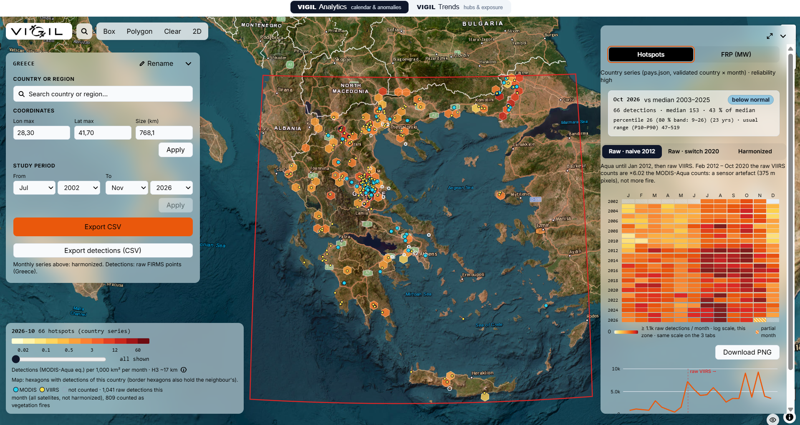
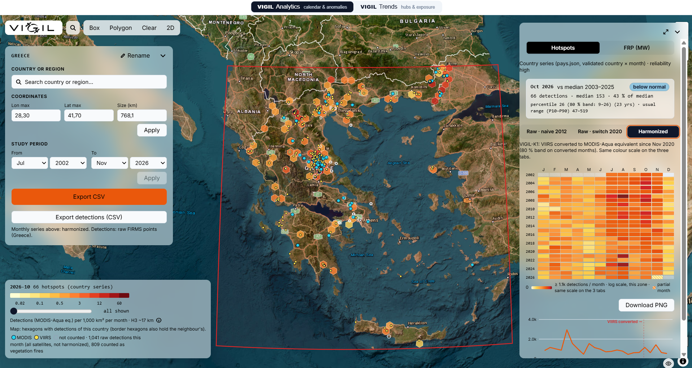

# Vigil, one fire calendar from 2002 to today, whatever the satellite

**NASA Space Apps Challenge 2026 · Paris · Challenge: *Harmonization of MODIS and VIIRS Hot Spots***

**Live app : [vigil-qarta.vercel.app](https://vigil-qarta.vercel.app)**

| Naive splice (raw VIIRS from 2012) | Vigil (harmonized) |
|---|---|
|  |  |

*Greece, Jul 2002 → Nov 2026, same cleaning and same colour scale. Left: the calendar darkens from 2012 because VIIRS sees more small fires. Right: VIGIL-K1 removes the jump, and the real big years (2007, 2021, 2023) stand out.*

| | |
|---|---|
| **0.948** | R² of monthly anomalies, each year predicted by a model that never saw it (235 countries, 20,235 country-months) |
| **79.7 %** | observed coverage of our 80 % uncertainty bands, out of sample |
| **E1 → E10** | every challenge requirement implemented in the app |

---

## Mission

The mission is to build a great interactive web app that fixes a major flaw in 25 years of NASA wildfire archives. If you plot raw NASA fire data from 2003 to today, it looks like global fires suddenly doubled in 2012, due to the fact that NASA switched from MODIS satellites (1km resolution) to VIIRS (375m resolution).

To address this, we developed a regression model that calibrates VIIRS detections back to a MODIS-Aqua baseline, flattening the 2012 jump into one continuous historical record.

Inside the app, users can move seamlessly from national 25-year trends down to local 17km H3 hexagonal cells. Because wildfire data is heavily skewed by catastrophic years, Vigil anchors its baselines on medians, IQRs, and $P_{10}$–$P_{90}$ bands rather than averages—making real anomalies immediately obvious ! It can also separate raw hotspot counts from Fire Radiative Power (MW), letting anyone distinguish a destructive forest megafire from routine agricultural brush burning.

This app could be truly useful for scientists, emergency planners, insurers, and governments who need to spot real climate anomalies and assess wildfire risk for critical infrastructure - basically anyone making high-stakes decisions around wildfire risk !

---

## Results at a glance

| Requirement | In Vigil |
|---|---|
| E1–E2 · One harmonized series | VIGIL-K1: k per country × day/night × month. Every converted month carries a provenance flag and an 80 % band |
| E3–E4 · Web app, region + period | Next.js + MapLibre on static pipeline output. Search by country, box, polygon or lat/lon |
| E5–E7 · Calendar, ranking, current vs median | Year × month calendar, Jul 2002 → Nov 2026. Anomalies, annual rank, % of the 2003–2025 median, percentile, 5-class verdict |
| E8–E9 · Downloads | Zone series CSV (bands + provenance), calendar PNG, raw detections CSV (Greece) |
| E10 · Accessibility | Colour-blind-safe ramps, always doubled by numbers |

The app also offers an H3 hexagon world map (with an equal-area Gall-Peters projection), an analyst dashboard, and a **Greece fire-by-fire view** with three tabs (*naive 2012*, *switch 2020*, *harmonized*) that isolate the effect of the harmonization. A second interface, **Vigil Trends**, maps recurring wildfire hubs.

### Validation: leave-one-year-out, world

| | R² | R² of anomalies | RMSE / SD | Bias | Skill vs one global k |
|---|---|---|---|---|---|
| Hotspots, country × month | 0.996 | **0.948** | 0.062 | −0.03 % | **0.88** |
| Σ FRP, country × month | 0.991 | 0.940 | 0.095 | −0.26 % | 0.72 |
| Hotspots, 2° cells (~222 km) | 0.974 | 0.826 | 0.162 | +0.57 % | 0.57 |
| Hotspots, 0.5° cells (~56 km) | 0.939 | 0.794 | 0.246 | +0.57 % | 0.38 |

How to read it:
- **R² of anomalies** scores the value minus the usual for that month. Seasonality alone already gives a high plain R², so anomalies are the hard part.
- **Skill 0.88**: VIGIL-K1 removes 88 % of the squared error left by a single global conversion factor.
- **Precision drops with scale** (skill 0.88 at country level, 0.38 on 56 km cells). The app widens the bands and flags zones smaller than the tested ones.

Mean Poisson deviance: 12.70. Band coverage: 79.7 % (80 %) and 94.9 % (95 %). Country reliability: 127 high, 24 medium, 84 low.

---

## Scientific approach

**Protocol, fixed before looking at results.** Target: monthly Aqua hotspots. Predictor: VIIRS hotspots on the same days and zone. Judge: leave-one-year-out cross-validation. Baselines to beat: climatology and k = 1 (no harmonization). Main criterion: **Poisson deviance**, the right loss for counts (RMSE is dominated by the largest months). Then total bias < 2 %, then parsimony.

```
NASA FIRMS CSV (43 GB, 10,191 country-year files + 2026 archive/NRT)
→ clean     confidence ≥ nominal; volcanoes, offshore flares, fixed industrial sites, duplicates removed
→ aggregate country × day × satellite × day/night, and H3 res-5 hexagon × month (DuckDB + h3)
→ harmonize VIGIL-K1 (counts) and VIGIL-K1-FRP (fire radiative power)
→ export    static files for the app (public/data/)
```

Every step counts what it removes (Greek funnel: `Donnees-propres/grece/entonnoir.csv`).

### Key decisions (full study: [`docs/methode_k.md`](docs/methode_k.md))

| Question | Decision | Evidence | Rejected alternative |
|---|---|---|---|
| Harmonize at all? | Yes | Raw VIIRS (k = 1) on Greece: R² = −52, bias +525 % | — |
| Reference sensor | **MODIS Aqua** | Terra/Aqua ratio drifts (Mann–Kendall p = 0.0003) | Terra, despite its earlier start |
| Calibration window | **2012-02 → 2020-10** | Pettitt change point in 2020-11 (p = 0.006): Aqua orbit drift | The full 2012–2025 overlap |
| Published value | Aqua observed before 2020-11, VIIRS converted after | A valid observation is never replaced by an estimate | — |
| Estimator | Ratio of totals ΣAqua / ΣVIIRS (Poisson MLE), bias ±0.5 % | 7 estimators compared | Mean or median of ratios, OLS, RMA, power law, quantile mapping |
| Stratification | Country × day/night × month, gamma–Poisson shrinkage (α by CV: 30 world, 10 regional) | Monthly split halves the deviance vs no split (13.3 vs 28.5) | Seasonal split |
| NOAA-20 | Chained to S-NPP (ρ ≈ 0.97) | Converted S-NPP and NOAA-20 agree within 5 %/year | Summing satellites (double-counts fires) |
| Uncertainty | Split-conformal, Mondrian by size class, on log(1 + x) | Coverage 77–79 % in every class | One global set of quantiles |
| FRP | Its own k (VIGIL-K1-FRP) | — | Reusing the count k |

### Statistics shown in the app (`app/zone.ts`, `app/stats.ts`)

- **Baseline**: complete years 2003–2025 only. Partial periods are compared year-to-date or flagged.
- **Percentiles**: Hyndman–Fan type 8; the rank excludes the year itself. On converted months, the percentile is given at both ends of the band, and a record is claimed only when the whole band exceeds the historical maximum.
- **Robustness**: distribution-free 95 % CI of the median (order statistics); trend = Sen's slope + Mann–Kendall.
- **Aggregation rule**: hexagons are summed first, statistics come after. Never a median of medians, never summed band bounds.
- Every figure is cross-checked against an independent NumPy computation.

### Vigil Trends ([`docs/methode_tf.md`](docs/methode_tf.md))

A hub is a place where real fire episodes recur. A hexagon-month is a "burst" when it reaches ≥ 4× its own median for that calendar month, so regular agricultural burning is removed by construction. Bursts are linked in space and time into episodes, then into hubs. Each hub gets a 1–100 score (frequency, magnitude, intensity) and a **bootstrap confidence** (500 resamples of the years). Face validity: the Greek hubs match the known fires (Attica 2009, Peloponnese 2007, Euboea 2021, Evros 2023) without the method knowing them.

---

## Resources used

Everything below is called by the code in this repository (versions from `package.json`, `requirements.txt`, `requirements-tf.txt`).

### Data

| Resource | Provider | Used for | Licence / terms |
|---|---|---|---|
| [FIRMS](https://firms.modaps.eosdis.nasa.gov) active fires: **MODIS Collection 6.1** (Terra + Aqua, 1 km) | NASA LANCE / ESDIS | Reference series (Aqua), 2000 → 2026 | NASA open data, citation requested (see *Credits*) |
| FIRMS **VIIRS 375 m Collection 2**: S-NPP and NOAA-20 | NASA LANCE / ESDIS | Series to harmonize, 2012 → 2026 (archive + near real time) | NASA open data |
| [Natural Earth](https://www.naturalearthdata.com) v5.1.2 admin-0 boundaries | Natural Earth | Country assignment of 2026 detections, zone search | Public domain |
| [ESA WorldCover](https://esa-worldcover.org) 2021 v200, via [Microsoft Planetary Computer](https://planetarycomputer.microsoft.com) | ESA | Land cover of fire regimes (Vigil Trends), external validation | CC BY 4.0 |
| [TerraClimate](https://www.climatologylab.org/terraclimate.html) (Abatzoglou et al. 2018), via Planetary Computer (Zarr) or the Climatology Lab THREDDS server | University of Idaho | Monthly climate of fire regimes (Vigil Trends) | CC0 |
| [AWS Terrain Tiles](https://registry.opendata.aws/terrain-tiles/) (Terrarium format) | Mapzen / AWS Open Data | Elevation of hexagons (Vigil Trends) | Open, attribution to sources |
| [Meteomatics Weather API](https://www.meteomatics.com) (optional) | Meteomatics | Monthly weather in the analyst dashboard | Commercial API, free tier, server-side keys |
| [Esri World Imagery](https://www.arcgis.com/home/item.html?id=10df2279f9684e4a9f6a7f08febac2a9) + Reference layers | Esri, Maxar, Earthstar Geographics | Satellite basemap of the web app | Esri terms of use, attribution shown on the map |

### Software: data pipeline (Python 3)

| Library | Used for |
|---|---|
| [pandas](https://pandas.pydata.org) ≥ 2.2, [NumPy](https://numpy.org) | Tables, aggregation, all computations |
| [DuckDB](https://duckdb.org) ≥ 1.1 | Fast SQL over 43 GB of FIRMS CSV |
| [PyArrow](https://arrow.apache.org/docs/python/) | Parquet intermediate files |
| [H3](https://h3geo.org) ≥ 4.0 (Uber) | Hexagonal grid (res 4–5) |
| [Shapely](https://shapely.readthedocs.io) ≥ 2 | Point-in-polygon, country geometry |
| [SciPy](https://scipy.org) | Statistical tests and distributions |
| [scikit-learn](https://scikit-learn.org) ≥ 1.7 | k-means, ARI, silhouette, gradient boosting / Poisson regression (tested forecast) |
| [numcodecs](https://numcodecs.readthedocs.io) | Decoding TerraClimate Zarr chunks (Blosc) |
| [netCDF4](https://unidata.github.io/netcdf4-python/) | Reading TerraClimate over OPeNDAP |
| [Pillow](https://python-pillow.org) | Decoding elevation tiles |
| [pytest](https://pytest.org) | Unit tests (`tests/`) |

### Software: web app

| Library / service | Used for |
|---|---|
| [Next.js](https://nextjs.org) 15, [React](https://react.dev) 18, [TypeScript](https://www.typescriptlang.org) 5 | App framework, API route for weather |
| [MapLibre GL JS](https://maplibre.org) 5 | Map, 3D globe, Gall-Peters equal-area projection (custom) |
| [h3-js](https://github.com/uber/h3-js) 4.2.1 | Hexagons in the browser |
| [Recharts](https://recharts.org) 2.15 | Charts of the dashboard |
| [Vercel](https://vercel.com) | Hosting of the live app |
| [GitHub](https://github.com) | Version control, collaboration |

### Use of artificial intelligence

We used **Claude Code (Anthropic)** as a coding assistant throughout the hackathon: writing and refactoring pipeline and front-end code, writing tests, and drafting documentation (commits co-written with it are marked `Co-Authored-By: Claude` in the git history). All scientific choices (reference sensor, calibration window, estimator, validation protocol) were made by the team and checked against the data, and every published number is reproducible with the commands in *Reproduce our numbers*. No AI-generated images, video or audio are used in the project.

### Methods

| Method | Used for | Why this one |
|---|---|---|
| Poisson maximum likelihood (ratio of totals) | Conversion factor k | Unbiased and conserves totals |
| Gamma–Poisson empirical Bayes shrinkage | k per country | Small countries borrow strength from their region |
| Leave-one-year-out cross-validation | Choice of α, all validation | Each year judged by a model that never saw it |
| Pettitt change-point test | Calibration window | Dates the Aqua drift |
| Mann–Kendall + Theil–Sen | Sensor drift, trends | Non-parametric, robust to outliers |
| MAD outlier rule (Iglewicz–Hoaglin) | Discordant calibration days | Robust to the outliers it detects |
| Split-conformal prediction (Mondrian) | 80 % / 95 % bands | Distribution-free coverage, per size class |
| Hyndman–Fan type 8, order-statistic CI | Percentiles, median CI | Median-unbiased, distribution-free |
| Bootstrap | Hub confidence | Measures how much a hub depends on a single year |
| Benjamini–Hochberg | Local trends (40,955 tests) | Controls false discoveries |
| k-means, ARI, silhouette | Fire regimes | Stability checked (ARI ≈ 0.95), validated on external land cover and climate |
| Confusion matrix | Industrial-site mask | Sensitivity 0.96, specificity 0.97 (VIIRS) |
| Equal-area projection, fixed geometric colour classes | Map | Densities comparable across latitudes and zoom levels |

---

## What didn't work

| We tried | What happened | What we did instead |
|---|---|---|
| Averaging monthly ratios (the intuitive k) | Biased by −6 % to −60 %, dominated by small unstable months | Ratio of totals |
| Calibrating on the whole 2012–2025 overlap | k rose significantly (p = 0.018): Aqua's orbit drifts later in the afternoon | Window cut at the 2020-11 change point |
| Terra as reference, to start in 2000 | Terra/Aqua ratio fell from 0.72 to 0.42 | Aqua only; series starts July 2002 |
| One set of uncertainty quantiles | 62 % coverage on small months, 97 % on large ones | Conformal quantiles per size class (77–79 % everywhere) |
| Reusing the count k for fire power | −75 % bias | Dedicated VIGIL-K1-FRP |
| Confirming the drift on the pooled world ratio | Pettitt not conclusive (p = 0.17) | Regional evidence only, stated as such |
| Reusing the regional α = 10 for the world | Not optimal on 235 countries | Re-chosen by cross-validation: α = 30 |
| Forecasting fire activity 1–5 years ahead | On Greece 2021–25, worse than the historical mean (log R² 0.33 vs 0.49); missed Euboea 2021 and Evros 2023 | Removed from the app: showing it would have been misleading |
| Persistence mask for industrial sites on MODIS | Catches 43 % (96 % on VIIRS) | Kept, limitation documented |

---

## Limitations

1. **Stationarity**: the VIIRS ↔ pre-drift Aqua relation is assumed to hold after 2020. It is supported by NOAA-20/S-NPP stability, but it cannot be checked against a stable MODIS.
2. **Below country scale**, precision drops (anomaly R² ≈ 0.8, median error ≈ 16 %). Low-reliability countries have wide bands.
3. **Coverage**: 235 calibrated countries, each with its reliability level shown in the app.
4. **2026 near-real-time rows** have no FIRMS `type`: industrial sites are removed with a persistence mask (see above). November 2026 is partial (until the 7th).
5. **Industrial fires are excluded** (Vigil tracks vegetation fires), but FIRMS labels some fixed sites as vegetation (52 % of detections in Saudi Arabia, 8 % in France on Aqua 2010). Not corrected.
6. **A detection is not a fire**: totals are MODIS-Aqua-equivalent detections, and Σ FRP is a sum of instantaneous powers (MW), not an energy.
7. **Point-level export** (E9) is available for Greece only. Vigil Trends' thresholds have not had a sensitivity analysis yet.

---

## Reproduce our numbers

| Claim | Command | Output |
|---|---|---|
| k study: estimators, window, α, bands | `python -m etudes.etude_k` | `docs/methode_k.md` |
| World calibration and validation | `python -m pipeline.v2.mondial calibrer` | Section *Validation* above |
| Greek cleaning funnel | `python -m pipeline.v2.nettoyage --region grece` | `Donnees-propres/grece/entonnoir.csv` |
| App statistics vs independent NumPy | `node scripts/test_stats.mjs --greece` | Console |
| Vigil Trends hubs | `python -m pipeline.tf.hubs` | `public/data/tf/hubs.json` |
| Unit tests | `python -m pytest` | `tests/` |

---

## Run it

**Web app** (data already in `public/data/`):
```bash
npm install
npm run dev   # http://localhost:3000
```

**Pipeline** (raw FIRMS files required; paths in `pipeline/v2/parametres.py`):
```bash
python -m pip install -r requirements.txt -r requirements-tf.txt
python -m pipeline.v2.mondial agreger
python -m pipeline.v2.mondial agreger --tables hex,jourfrp
python -m pipeline.v2.mondial calibrer
python -m pipeline.v2.mondial calibrer-frp
python -m pipeline.v2.nettoyage --region grece
python -m pipeline.v2.export_site --site public/data
python -m pipeline.v2.export_h3_pays --site public/data
python -m pipeline.v2.export_calendrier_brut --pays Greece --site public/data
```

Weather in the dashboard is optional (Meteomatics; `MM_USER` / `MM_PASS` server variables).

## Repository

| Path | Content |
|---|---|
| `app/` | Web app: map and panel (`Vigil.tsx`), analyst dashboard (`DeepDive.tsx`), statistics (`zone.ts`, `stats.ts`) |
| `pipeline/v2/` | Cleaning, aggregation, calibration (VIGIL-K1, K1-FRP), exports |
| `pipeline/tf/` | Vigil Trends: hubs, regimes, trends |
| `etudes/` | Reproducible method studies |
| `docs/` | Method studies (`methode_k.md`, `methode_tf.md`), data contract, colour legend |
| `tests/`, `scripts/` | Python tests, statistics tests (JS vs NumPy) |
| `public/data/` | Pre-computed static data served to the app (no raw data, no keys) |

---

## Team & credits

Built by team **Vigil** for NASA Space Apps Challenge 2026, Paris.
| Member | Role |
|---|---|
| Alix Outil | Backend and data science |
| Aramis Sandoz | Backend and frontend |
| Paul Metz | Frontend, UI, UX |

We used data from NASA's FIRMS, part of NASA's ESDIS.

Main references: Giglio, Schroeder & Justice 2016 (*RSE* 178:31) · Schroeder et al. 2014 (*RSE* 143:85) · Fu et al. 2020 (*Remote Sensing* 12:2870) · Pettitt 1979 · Mann 1945 / Kendall 1975 · Iglewicz & Hoaglin 1993 · Vovk et al. 2005, Lei et al. 2018 (conformal prediction).
